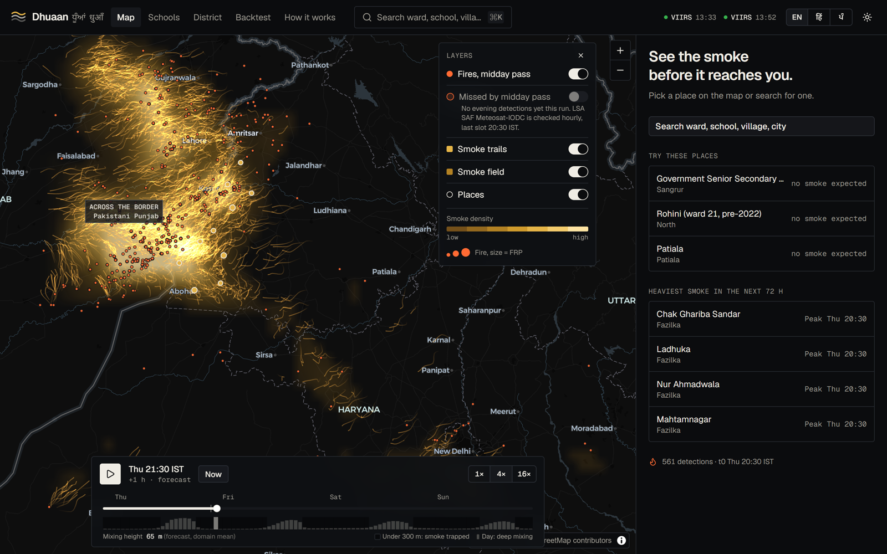
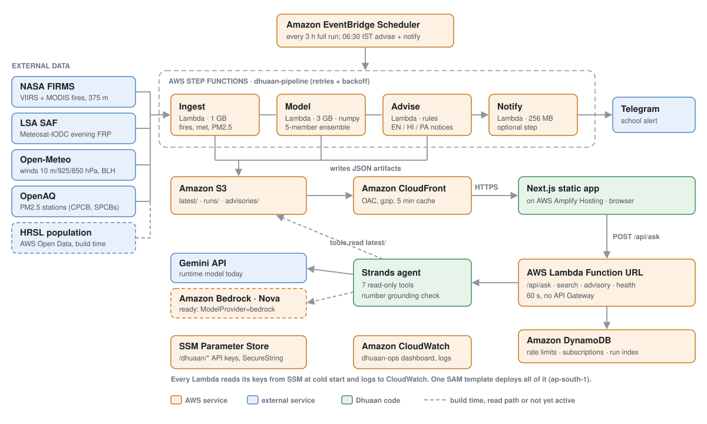

# Dhuaan · ਧੂੰਆਂ · धुआँ

**See the smoke before it reaches you.** An hour-by-hour stubble-smoke forecast for North India that ranks tonight's farm fires by the harm they do downwind and writes school advisories in Punjabi, Hindi and English. It runs serverless on AWS, on the Free plan.

     


<sub>Hero image `docs/img/hero.png` is captured from the deployed site before submission (TODO).</sub>

| | |
|---|---|
| Live site (no login) | **TODO:** `https://main.<appid>.amplifyapp.com` |
| Demo video (2:55) | **TODO:** YouTube link |
| Write-up | [docs/WRITEUP.md](docs/WRITEUP.md) |
| Method | [docs/method.md](docs/method.md) |
| Builder Center article | **TODO:** link ([draft](docs/BLOG.md)) |

Built for the WeMakeDevs x AWS Environmental Hacks (Air track), 8 to 11 Oct 2026, by one person.

## The problem

Punjab reported 5,114 farm fires between 15 Sep and 30 Nov 2025, down from 10,909 in 2024 and 83,002 in 2020 ([CityAirNews, citing the environment ministry](https://www.cityairnews.com/content/5114-farm-fires-reported-in-punjab-since-sep-15-mos-kirti-vardhan-singh)). Those counts come from polar-orbiting satellites that pass over Punjab around 13:30 IST.

The burning moved later in the day. Of 33,074 geostationary GK2A fire detections over Punjab between 12:00 and 18:59 IST in Oct to Nov 2025, **93% came at or after 16:00 IST**, after the last polar pass (GK2A-AMI hourly fire detections, Jethva 2026, NASA GSFC / Morgan State Univ., [doi:10.5281/zenodo.20084790](https://doi.org/10.5281/zenodo.20084790), CC BY 4.0; computed in [`backend/data/facts.json`](backend/data/facts.json)).

Smoke from evening fires settles at night, when the boundary layer is a few hundred metres deep, so the villages and schools next to the fields breathe it first. Nobody tells a school principal in Sangrur at 06:30 whether to hold assembly outside.

## Who it's for

| Persona (fictional) | What they get |
|---|---|
| Harpreet Kaur, principal of a government senior secondary school in Bhawanigarh, Sangrur | A 07:00 to 14:00 school-day plan (outdoors OK, short light activity, keep indoors) and a parent notice in ਪੰਜਾਬੀ, हिंदी and English, sent to Telegram at 06:30 IST. |
| A cluster officer on the Sangrur field team | Tonight's fire clusters ranked by the people-hours of smoke they cause over the next 48 h, filterable to India only or one district, with a CSV export. |
| A parent in Rohini, Delhi | When smoke arrives at their ward, how bad it gets, and which districts it came from, with a link to share. |

The school is a real OpenStreetMap school (`osm-w1090680897`); the people are invented.

## What it does

- Smoke map. Particle trails from every fire cluster of the last 48 h, played hour by hour over the next 72 h on a deck.gl map, with the smoke field, fire sizes by FRP and a mixing-height band that shows why nights are worse.
- Place forecast. Search any of 2,316 villages, towns, cities, schools or pre-2022 Delhi wards. You get arrival time and window, peak, a 72 h median with a p10 to p90 band, the nearest monitor reading and "where your air is from" by district.
- Ask Dhuaan. A Strands agent answers questions in English, Hindi or Punjabi using 7 read-only tools over the forecast. Every number in the answer is checked against the tool results, and the UI shows a badge such as "5/5 numbers verified" next to the tool trace.
- School day planner. Hourly outdoor guidance from CPCB NAQI bands, plus the trilingual parent notice. The daily run delivers it to Telegram.
- District fire list. Clusters ranked by exposure. In the 8 Oct 2026 12:00 UTC run, 19 of 80 clusters in India caused 60% of the exposure from Indian fires. Fires across the border in Pakistani Punjab (240 clusters) stay on the map and are hidden from the list by default, since a district team can't act on them.
- Backtest page. The pre-registered A vs B replay of the November 2025 smoke season, with its weak result shown as it is.
- Light and dark themes, three UI languages, a freshness chip for every data source and a "sample data" badge whenever the data is synthetic.

## Architecture



Everything is in one SAM template ([`infra/template.yaml`](infra/template.yaml)) in ap-south-1 (Mumbai): zip Lambdas with two prebuilt layers, no containers, no VPC or NAT, no always-on compute.

| AWS service | What it does in Dhuaan |
|---|---|
| Amazon EventBridge Scheduler | Starts the full pipeline every 3 h (`PipelineRateHours`) and an advise + notify run at 06:30 IST, before school. |
| AWS Step Functions (Standard) | Runs Ingest → Model → Advise → Notify with per-step retries and backoff. A Notify failure never fails the run. About 6 state transitions per run. |
| AWS Lambda | `ingest` pulls fires, winds and PM2.5. `model` runs the 5-member smoke ensemble in numpy (3 GB). `advise` writes school plans and trilingual notices. `notify` sends Telegram alerts. `api` serves search, advisories and the agent. |
| Lambda layers | `dhuaan-deps` (numpy, h5py, requests) and `dhuaan-agent` (Strands + Gemini SDK), 112 MB together, built from manylinux wheels on Windows without Docker. |
| Lambda Function URL | The public HTTPS endpoint for `/api/*`. No API Gateway, so agent answers aren't capped at 30 s. |
| Amazon S3 | Private artifact store: `latest/` (what the map reads), `runs/<run_id>/` (30-day history), `raw/` (14 days), advisories and cached answers. |
| Amazon CloudFront | Serves the artifacts over HTTPS from Indian edge locations through Origin Access Control, with compression and a 5-minute cache on `latest/`. |
| Amazon DynamoDB | One on-demand table with TTL: API rate limits (20 asks per IP per hour, 500 per day overall), subscriptions and the run index. |
| AWS Systems Manager Parameter Store | API keys as SecureString parameters under `/dhuaan/`, read by each Lambda at cold start. |
| AWS Amplify Hosting | Hosts the Next.js static export (manual zip deploy). |
| Amazon CloudWatch | The `dhuaan-ops` dashboard (executions, failures, durations, errors, API traffic) and 14-day logs. |
| Amazon Bedrock | IAM is already granted for Nova 2 Lite. The agent runs on Gemini today because Bedrock is blocked on this new account (see below); switching is one parameter, `ModelProvider=bedrock`. |
| AWS Open Data | HRSL population tiles read from `s3://dataforgood-fb-data/hrsl-cogs/` at build time; the OpenAQ archive `s3://openaq-data-archive` for backtest observations. |

A full run on 8 Oct 2026 (12:00 UTC) modelled 447 fire detections in 320 clusters with 15,158 particles; the model step took 3.75 s. Cost estimates per service are in [`infra/README.md`](infra/README.md#cost-on-the-free-plan-rough-monthly-figures-at-the-default-3-h-rate).

## How the model works

Full equations and parameters: [docs/method.md](docs/method.md).

1. Fires to sources. FIRMS VIIRS and MODIS detections from the last 48 h, minus anything within 1 km of 96 static industrial hotspots, are clustered (1.5 km, 6 h). Each detection emits FRP × 2 h × 0.02 kg PM2.5 per MJ. Evening fires come from LSA SAF Meteosat-IODC when it sees them; otherwise a per-district afternoon ratio built from the 2025 GK2A data estimates the missed burning between 16:00 and 19:00 IST.
2. Transport. Particles ride the mixed-layer mean wind (10 m, 925 and 850 hPa from Open-Meteo, depending on boundary-layer height) with a random walk whose strength grows with mixing depth. A 5-member ensemble perturbs wind speed (±15%), direction (±15°) and diffusion.
3. Concentration. Particle mass is smoothed with a 10 km Gaussian kernel and divided by boundary-layer height, which is why a shallow night layer traps smoke. The member median is the forecast; p10 and p90 are the band. A calibration factor α from the backtest turns smoke units into estimated PM2.5 (pooled 0.164; provisional regional values in Delhi/NCR and Punjab/Haryana, see below).
4. Attribution and exposure. Every particle keeps its cluster label, so each place's smoke splits exactly by source district. Each cluster is scored by population × smoke × hours over the next 48 h (HRSL population, school cells weighted 1.5× during school hours).

In the 8 Oct 2026 12:00 UTC run, clusters in Pakistani Punjab account for 85% of all modelled exposure in the domain, which includes people on both sides of the border. For places in Indian Punjab, 73% of the population-weighted smoke forecast for the next 48 h is attributed to districts across the border (computed from `places/*.json`; mostly Kasur, Pakpattan and Okara smoke reaching Firozpur, Fazilka and Muktsar). These shares change with every run and every wind shift.

## Backtest

The protocol was fixed before the run ([method](docs/method.md#backtest-protocol-pre-registered)): daily forecasts issued at 05:30 IST from 24 Oct to 20 Nov 2025, scored at 12 to 35 h lead against 9 government PM2.5 monitors (6 in Punjab, 3 in Delhi). α was fitted on 25 Oct to 5 Nov; everything below is on the held-out 6 to 20 Nov. An episode is 3 or more hours with PM2.5 excess of at least 60 µg/m³; a hit is a forecast reaching 60 within 6 h of it.

- A: FIRMS VIIRS/MODIS only (what a forecaster has today).
- B: A plus GK2A geostationary afternoon detections (what hourly afternoon fires would add).

| Held-out metric (6 to 20 Nov 2025) | A | B |
|---|---|---|
| Episodes hit | 0 of 91 | 1 of 91 |
| False-alarm ratio | n/a (no forecast episodes) | n/a (no forecast episodes) |
| Median lead time | n/a | 14 h (one episode) |
| Pearson r, all station-hours pooled | 0.131 | 0.229 |
| R² (with α) | −0.428 | −0.415 |
| Pearson r, Rohini (Delhi) | 0.397 | 0.451 |
| Pearson r, Anand Vihar (Delhi) | 0.408 | 0.450 |
| Pearson r, Punjabi Bagh (Delhi) | 0.416 | 0.485 |

Source: [`backend/out/latest/backtest.json`](backend/out/latest/backtest.json). A same-day check at 0 to 23 h lead, not pre-registered, gives 1 vs 2 hits of 91 and r 0.133 vs 0.209.

What it means: as an episode detector at the 60 µg/m³ threshold, the model has almost no skill on this test. Adding the afternoon fires improves the correlation with observed smoke excess (pooled r 0.13 to 0.23, and higher at all three Delhi stations), which supports the idea that the missed evening burning matters downwind. The skill it does show is weak, and the met archive used here is somewhat better than a live forecast, so treat these numbers as an upper bound.

Why the hit rate is near zero: a single α is pooled over all stations. The Punjab monitors, where the model is noisy close to the fires, pull it down to 0.164; fitted on Delhi alone it would be about 7 to 9. Calibrated forecasts then rarely reach 60 µg/m³. In Delhi the observed excess also includes local and regional pollution that a fire-only model cannot see.

### Exploratory, not pre-registered: regional calibration

After seeing the pooled result I fitted one α per region on the same fit period (25 Oct to 5 Nov) and scored the same saved forecasts on 6 to 20 Nov. This was decided after looking at the data, so it is not evidence in the way the table above is.

| Region (stations) | α, A | α, B | Episodes hit, A | Episodes hit, B | Pearson r, A | Pearson r, B |
|---|---|---|---|---|---|---|
| Delhi/NCR (3 DPCC) | 8.95 | 6.80 | 57 of 57 | 57 of 57 | 0.396 | 0.451 |
| Punjab/Haryana (6 PPCB) | 0.172 | 0.149 | 0 of 34 | 0 of 34 | 0.205 | 0.214 |
| All 9 stations | | | 57 of 91 | 57 of 91 | 0.131 | 0.229 |

Median lead for the hits is 63 h with no false alarms, but read the Delhi row with care. On held-out hours the observed Delhi excess was at or above 60 µg/m³ 78% of the time, and so was the regionally calibrated forecast (B), so a forecast that is high most of the time scores well on episodes without tracking them. R² is strongly negative (−5.57 for B in Delhi), so the magnitudes are off. The Delhi α rests on 3 stations and also absorbs local non-fire pollution. Pearson r does not depend on α, so it is unchanged. The live pipeline uses these regional values as a provisional calibration in Delhi/NCR and Punjab/Haryana and the pooled α elsewhere.

### Limitations

- Fire smoke only: no traffic, industry, dust, chemistry or secondary aerosol. Estimated PM2.5 is a smoke increment plus a baseline, not a full air-quality forecast.
- One lumped removal time, no plume rise, a mixed-layer mean wind and literature-style emission constants.
- The live evening-fire feed (LSA SAF Meteosat-IODC) reported no detections in the domain on 8 Oct 2026, early in the season. The estimated afternoon ratio is a pixel-count ratio between sensors with very different footprints.
- The pooled calibration (above) is dominated by Punjab stations.
- NAQI bands are 24-hour averages, applied to hourly estimates as a guide.
- OSM school coverage is incomplete, HRSL population is 2016-era and Delhi wards use pre-2022 boundaries.
- The personas are fictional. No school or district office has used Dhuaan yet.

## Run it

### Locally

Requirements: [uv](https://docs.astral.sh/uv/), Python 3.12, Node 20+ (24 used here). Copy `.env.example` to `.env` and fill in the free keys (NASA FIRMS map key, OpenAQ, Gemini, optional LSA SAF account and Telegram bot).

```bash
cd backend
uv sync
uv run python -m dhuaan.pipeline.run_local          # ingest + model, writes backend/out/latest/
uv run python -m dhuaan.agent.advisory              # school plans + trilingual notices
uv run python -m dhuaan.api.local                   # API on http://localhost:8787
uv run python -m dhuaan.backtest.run --members 3    # optional: the Nov 2025 backtest (slow, cached)
```

```bash
cd web
npm install
npm run data:sync      # copies backend/out/latest into public/data/latest
npm run dev            # http://localhost:3000
```

`npm run data:fixtures` writes synthetic data instead; the UI then shows a "Sample data" badge.

### On AWS

Requirements: AWS CLI v2 signed in, SAM CLI 1.120 or newer, uv, Node 20+. From the repo root on Windows:

```powershell
.\infra\deploy.ps1 -Web        # stage code, build layers, sam build + deploy, push secrets to SSM, deploy web to Amplify
.\infra\deploy.ps1 -Origin https://main.<appid>.amplifyapp.com   # lock API CORS to the site
```

The same steps on macOS or Linux: `infra/deploy.sh --web`. By hand, the core is `cd infra && sam build && sam deploy`. Teardown, stack parameters and the Free-plan cost table are in [`infra/README.md`](infra/README.md).

## Tests

```bash
cd backend && uv run pytest -q                        # 184 tests
uv run --project backend pytest -q infra/tests        # 9 tests
```

| Suite | Tests | What it checks |
|---|---|---|
| `tests/model` | 32 | Physics invariants: displacement in uniform wind within 1%, mass conservation, exponential decay, the kernel integrating to 1, halving BLH doubling concentration, attribution shares summing to 1, the adjoint exposure equalling the forward sum, schema validity and determinism. |
| `tests/agent` | 69 | Tool outputs, NAQI rules, the number-grounding checker in three scripts, script purity for Hindi and Punjabi, the Gemini fallback chain and a scripted-model agent loop. |
| `tests/ingest` | 33 | FIRMS, LSA SAF, Open-Meteo and OpenAQ parsers on recorded fixtures, and the static hotspot mask. |
| `tests/api`, `tests/geo`, `tests/backtest`, `tests/pipeline` | 14, 14, 11, 11 | API routes and rate limits, district and population data, the pre-registered metric definitions, the end-to-end pipeline and Telegram formatting. |
| `infra/tests` | 9 | SAM template contract, state machine ASL, staging and layer limits. |

Counts are from `pytest --co` on 8 Oct 2026.

## Repo layout

```
backend/
  dhuaan/model/       smoke model: clusters, emission, transport, concentration, attribution, exposure
  dhuaan/ingest/      FIRMS, LSA SAF, Open-Meteo, OpenAQ clients
  dhuaan/geo/         districts, receptors, HRSL population (pure-Python COG reader)
  dhuaan/pipeline/    run_local and the Step Functions Lambda handlers
  dhuaan/agent/       Strands agent, 7 tools, NAQI rules, grounding check, advisories
  dhuaan/api/         Lambda Function URL handler, local dev server, rate limits
  dhuaan/backtest/    GK2A loader, hotspot mask, afternoon ratio, pre-registered metrics
  data/               small static data (districts, receptors, population, facts) + SOURCES.md
  tests/              pytest per component
infra/                SAM template, state machine, layer builder, deploy scripts
web/                  Next.js 16 static export (shadcn/ui, MapLibre, deck.gl)
docs/                 method, write-up, blog draft, video plan, architecture, contracts
```

## AI tools used

- Claude Code (Anthropic) wrote most of the code, tests and docs under my direction, with parallel agents per component. I chose the design, checked the physics and the numbers, and made the calls on what to cut.
- At runtime the Strands agent and the advisory notices use Google Gemini (`gemini-flash-lite-latest`, with a fallback chain) through the Strands Agents SDK. The code is ready for Amazon Bedrock Nova 2 Lite (`MODEL_PROVIDER=bedrock`); Bedrock was blocked on the new AWS account during the event.
- When the model writes Hindi or Punjabi in the wrong script, or a number fails the grounding check, the notice falls back to hand-written templates, so no published notice carries an unverified number.

## Data sources and licences

| Dataset | Used for | Licence |
|---|---|---|
| NASA FIRMS VIIRS (S-NPP, NOAA-20, NOAA-21) and MODIS | Fire detections | NASA open data |
| EUMETSAT LSA SAF Meteosat-IODC FRP-PIXEL | Evening fires with FRP | LSA SAF data policy (free, non-commercial, registration) |
| Open-Meteo Forecast and Historical Forecast APIs | Winds and boundary-layer height | CC BY 4.0 |
| OpenAQ v3 API and AWS archive | PM2.5 now and backtest observations (CPCB, DPCC, PPCB, HSPCB and others) | CC BY 4.0; provider terms |
| Meta / CIESIN HRSL v1.5.2 (AWS Open Data) | Population per 0.1° cell | CC BY 4.0 |
| geoBoundaries IND ADM2 / PAK ADM1-2 | District lookup | ODbL 1.0 / public domain |
| geoBoundaries IND ADM1 (DataMeet) | State names | CC BY 2.5 IN |
| GeoNames | Villages, towns, cities | CC BY 4.0 |
| OpenStreetMap (`amenity=school`) | Schools | ODbL 1.0 |
| DataMeet Municipal Spatial Data | Pre-2022 Delhi wards | CC BY-SA 2.5 IN |
| NASA GSFC GK2A hourly fire detections (Zenodo 10.5281/zenodo.20084790) | Backtest B, afternoon ratio, the 93% fact | CC BY 4.0 |

Full attribution lines are in [`backend/data/SOURCES.md`](backend/data/SOURCES.md). NAQI bands follow CPCB (2014); school guidance follows CAQM GRAP and MoHFW advisories.

## Team

Shrey Sati, solo ([@satanrayshe](https://github.com/satanrayshe), [@shreysati](https://builder.aws.com) on AWS Builder Center).

## Licence

Code: [MIT](LICENSE). Data keeps its own licence (table above); derived Delhi ward centroids are CC BY-SA 2.5 IN.
